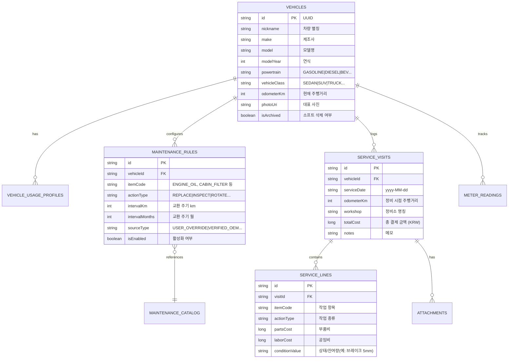

# 마하개러지 (MahaGarage) — 앱 아키텍처 및 구현 설계서

- **문서 버전:** 1.0.0
- **작성일:** 2026-10-16
- **대상 패키지:** `Maha.Garage` (Android Native, Kotlin, Jetpack Compose)
- **참조 명세:** `Multi_Vehicle_Maintenance_App_Spec.md` 및 `google-services.json`
- **핵심 목표:** 단순 차계부를 넘어, **다양한 동력계(가솔린/디젤/하이브리드/전기차)와 차체(승용/트럭/특장)에 맞춘 OEM 기반 정밀 소모품·정비 관리 시스템 구축**

---

## 1. 프로젝트 비전 및 핵심 설계 철학

### 1.1 차별화된 핵심 가치
1. **동력계 × 차체 2축 독립 모델링:**
   - 경유 트럭(디젤+상용차), 전기 화물차(BEV+상용차), 가솔린 하이브리드(가솔린+하이브리드) 등 실제 차량 구성을 정밀 반영.
   - 전기차에 엔진오일이 추천되거나, 상용차에 승용차식 타이어 교환이 적용되는 오류를 원천 차단.
2. **OEM 제조사 기준 신뢰도 계층 시스템 (Priority Hierarchy):**
   - `USER_OVERRIDE` (사용자 직접 지정) > `VERIFIED_OEM` (제조사 공시 정비표) > `OEM_FAMILY` (동일 파워트레인 계열) > `GENERIC_ESTIMATE` (일반 권장 추정치) > `NOT_CONFIGURED` (확인 필요).
   - 데이터 근거가 없는 경우 억지로 알림을 만들지 않고 "제조사 기준 확인 필요"로 안내.
3. **정상 vs 가혹조건의 현실적 분리:**
   - 근거 없는 '주기 50% 일괄 삭감'을 금지하고, 제조사 가혹조건 정비표 유무를 감지하여 차등 반영.
4. **점검(INSPECT)과 교체(REPLACE)의 분리:**
   - 정기 점검 기록이 부품 교체 수명 주기를 초기화하지 않도록 데이터 구조 분리.
5. **다중 항목 정비 방문(Service Visit & Lines) 구조:**
   - 카센터 1회 방문 시 엔진오일, 에어컨 필터, 브레이크 패드를 함께 교체하고 영수증 사진 및 총비용을 묶어서 관리.

---

## 2. 기술 스택 및 라이브러리 구성

| 구분 | 기술 스택 / 라이브러리 | 용도 및 선정 사유 |
|---|---|---|
| **OS / Platform** | Android (Min SDK 26, Target SDK 35) | 안드로이드 최신 표준 및 광범위한 기기 호환성 |
| **Language** | Kotlin 2.0+ (Coroutines, Flow) | 비동기 반응형 데이터 스트림 처리 |
| **UI Framework** | Jetpack Compose + Material 3 | 선언형 UI, 다이내믹 컬러, 현대적인 모바일 UX/UI |
| **Architecture** | MVVM + Clean Architecture | UI / Domain(Rule Engine) / Data 계층의 엄격한 분리 |
| **Local Database** | Room (SQLite) + KSP | 오프라인 우선(Offline-First) 데이터 영속성 보장 |
| **Settings / Cache** | Jetpack DataStore (Preferences) | 테마, 알림 시간, 정합성 캐시 저장 |
| **Background Tasks** | AndroidX WorkManager | 배터리 절약형 백그라운드 정비 만기 점검 및 로컬 알림 |
| **Image / Media** | Android Modern Photo Picker + Coil | 영수증 및 정비 사진 안전 저장/불러오기 |
| **Cloud / Backend** | Firebase (Auth, Firestore, Storage) | `google-services.json` 연동 클라우드 백업 및 동기화 기반 |
| **Export / Import** | Kotlinx Serialization (JSON) + CSV | 사용자 데이터 완전 소유권 및 백업/복원 |

---

## 3. 핵심 도메인 및 룰 엔진 설계

### 3.1 동력계 및 차체 분류 (2-Axis Separation)

```mermaid
graph TD
    subgraph PowertrainType [동력계 (Powertrain)]
        GASOLINE[휘발유]
        DIESEL[디젤]
        LPG[LPG]
        HEV_GASOLINE[휘발유 하이브리드]
        PHEV_GASOLINE[플러그인 하이브리드]
        BEV[순수 전기차]
    end

    subgraph VehicleClass [차체/용도 (Vehicle Class)]
        SEDAN[세단]
        SUV[SUV]
        VAN[밴]
        PICKUP[픽업트럭]
        LIGHT_TRUCK[1톤/소형 화물]
        MEDIUM_HEAVY_TRUCK[중/대형 화물]
        BUS[버스]
    end

    PowertrainType --> Engine[소모품 적용성 엔진 ApplicabilityEngine]
    VehicleClass --> Engine
    Engine --> MaintenanceRules[맞춤형 정비 카탈로그 생성]
```

- **BEV 자동 제외 품목:** 엔진오일, 오일필터, 에어크리너, 점화플러그, DPF, 요소수(SCR), 타이밍벨트.
- **HEV/PHEV 추가 항목:** 엔진 클러치 액추에이터 오일, HSG 구동벨트, 고전압 배터리 냉각수/흡입구 필터.
- **디젤 전용 항목:** 연료필터 수분분리기, DPF 차압 및 재생 점검, SCR/요소수.
- **트럭/상용차 오버레이:** 에어드라이어 카트리지, 공압 누설 점검, 섀시 그리스 니플 주입, 디퍼렌셜 오일, 휠베어링/허브 그리스, PTO 작동유.

### 3.2 정비 도래 판정 알고리즘 (Schedule Evaluator)

```kotlin
// 도래 판단 기준: 주행거리 OR 경과 개월 OR 엔진 가동시간 중 최초 도래값
data class RuleInterval(val km: Int?, val months: Int?, val engineHours: Int?)

enum class DueStatus {
    OVERDUE,      // 이미 만료됨 (즉시 조치)
    DUE_NOW,      // 당일 또는 기준 도달
    DUE_SOON,     // 임박 (남은 1,000km 이내 or 30일 이내 or 20시간 이내)
    INSPECTION_DUE,// 육안/측정 점검 권장 시점
    NORMAL,       // 여유 상태
    NEEDS_DATA    // 주행거리 미갱신 또는 기준 미설정
}
```

- **최초 주기 / 반복 주기 분리 (First vs Repeat):**
  - 예: 냉각수 — 출고 후 최초 100,000km / 120개월, 이후 40,000km / 24개월마다 반복.
- **주행거리 역행 방지 및 보정:**
  - 신규 입력된 주행거리가 기존보다 작을 경우 경고 및 계기판 교체 여부 확인 모달 제공.

---

## 4. 데이터베이스 스키마 설계 (Room Entities)



---

## 5. UI/UX 화면 구성 및 사용자 플로우

```
[앱 실행]
   │
   ├── ① 온보딩 / 차량 등록 마법사 (차종, 연식, 동력원, 주행거리, 운행환경 선택)
   │      └── 자동 소모품 카탈로그 추천 및 사용자 커스텀 확인
   │
   ├── ② 통합 대시보드 (Home)
   │      ├── 등록 차량 슬라이더/카드 (대표사진, 누적 주행거리, 월평균 주행거리)
   │      ├── 정비 브리핑 (초과 N건, 곧 도래 N건, 점검 필요 N건)
   │      ├── 가장 빠른 예정 정비 타임라인
   │      └── 빠른 주행거리 업데이트 플로팅 버튼
   │
   ├── ③ 차량 상세 & 소모품 현황판
   │      ├── 카테고리별 소모품 그리드 (파워트레인 / 제동 / 섀시 / 필터)
   │      ├── 진행 게이지 바 (잔여 km 및 잔여 일수)
   │      └── 신뢰도 배지 (`VERIFIED_OEM`, `USER_SET`, `ESTIMATE`)
   │
   ├── ④ 정비 기록 추가 (원스톱 다중 입력)
   │      ├── 방문 날짜, 정비소명, 방문 당시 주행거리
   │      ├── 교체/점검 항목 다중 체크 (각 항목별 부품비, 공임비 분리 입력)
   │      ├── 영수증/정비내역서 사진 첨부 (Photo Picker)
   │      └── [저장] 즉시 해당 소모품 다음 교체 시점 자동 재계산
   │
   ├── ⑤ 정비 이력 및 지출 통계
   │      ├── 타임라인별 정비 기록 열람 및 수정
   │      ├── 월별 / 연도별 차량 유지비 지출 차트
   │      └── 정비 이력 CSV / PDF 내보내기 (중고차 매매 증빙용)
   │
   └── ⑥ 설정 및 데이터 관리
          ├── 알림 기준 설정 (사전 1,000km, 30일 전 등)
          ├── 로컬 백업 생성 및 복원 (JSON)
          └── Firebase 계정 연동 및 클라우드 동기화
```

---

## 6. 개발 단계별 구현 로드맵 (Roadmap)

### 📌 1단계: 프로젝트 환경 구축 및 기초 데이터 레이어 (Foundation) [완료 ✅]
- Android Studio 프로젝트 뼈대 생성 (Package: `Maha.Garage`).
- `build.gradle.kts` 의존성 및 Java 25 & Gradle 9.1 지원 세팅 완료.
- `google-services.json` 연동 및 Firebase 초기화 설정.
- Room Entity, DAO, TypeConverters 및 Database 클래스 구현.
- 초기 카탈로그 데이터셋 (JSON Seeder) 작성: 승용 가솔린/디젤/HEV/PHEV/BEV 및 상용 트럭 오버레이.

### 📌 2단계: 핵심 도메인 및 룰 엔진 구현 (Core Domain Engine) [완료 ✅]
- `ApplicabilityResolver`: 차량 사양(파워트레인 × 차종 2축)에 따른 소모품 자동 추출 및 가혹조건 단축 엔진.
- `MaintenanceScheduleEngine`: 거리/날짜/엔진시간 기준 잔여 수명 및 상태(`OVERDUE`, `DUE_SOON`, `NORMAL` 등) 5단계 산출기.
- `TireSwapCalculator`: 섬머/윈터 타이어 주행거리 분리 누적 및 실시간 스왑 추적 엔진.
- 단위 테스트(Unit Tests) 11건 100% 통과 검증 완료 (`11/11 SUCCESS`).

### 📌 3단계: Jetpack Compose 기반 프리미엄 UI 구축 (UI Layer) [완료 ✅]
- 건메탈 다크 모드 기반의 프리미엄 오토모티브 디자인 시스템 (`Theme.kt`, `Color.kt`, `Type.kt`).
- 재사용 핵심 컴포넌트: `StatusBadge`, `SourceBadge`, `ProgressGauge`, `TireModeBadge`, `SectionHeader`.
- **화면 및 네비게이션 구현:**
  1. `MainAppScreen`: 바텀 네비게이션(대시보드, 내 차량, 정비 이력, 설정) 및 `NavHost` 연동.
  2. `DashboardScreen`: 관리 차량 카드 슬라이드, 긴급 정비 경고 배너, 통합 만기 현황, 퀵 주행거리/타이어 스왑 다이얼로그.
  3. `VehicleListScreen`: 보유 차량 카드 리스트, Worst Status 배지, 신규 차량 등록 FAB.
  4. `VehicleDetailScreen`: 소모품 P1~P5 우선순위 필터, 게이지 프로그레스, OEM 출처 표기, 규칙 수정 바텀시트, 타이어 스왑 패널.
  5. `AddEditVehicleScreen`: 2축 분리(파워트레인 × 차종) 선택 마법사, 가혹운행 토글, 섬머/윈터 타이어 초기 세팅.
  6. `AddServiceVisitScreen`: 1회 방문 다중 정비 품목(부품비, 공임비, 규격, 잔여 상태치) 등록 및 영수증 입력.
  7. `ServiceHistoryScreen`: 정비 타임라인 탭(총 지출 요약) + 타이어 스왑 로그 탭(교체 일자, 마일리지, 잔여 트레드 깊이, 보관소).
  8. `SettingsScreen`: 만기/임박/환절기 스왑 알림 토글, 5단계 OEM 계층 설명, 로컬 오프라인 DB 상태 안내.
- **빌드 검증:** `app-debug.apk` (23.3MB) 클린 컴파일 및 패키징 완료.

### 📌 4단계: 백그라운드 워커 및 로컬 알림 (System Integration) [완료 ✅]
- `NotificationHelper`: 정비 만기/초과 알림 채널(HIGH) 및 환절기 타이어 스왑 알림 채널(DEFAULT) 분리 등록.
- `MaintenanceNotificationWorker`: CoroutineWorker 기반 매일 전 차량 소모품 잔여 수명 평가 및 환절기(3~4월 섬머 교체, 11~12월 윈터 교체) 스마트 푸시 자동 발송.
- `WorkManagerScheduler`: 24시간 주기 배터리 세이프티 백그라운드 작업 등록 및 설정 화면 즉시 실행 OneTime 트리거.
- Android 13+ (API 33+) `POST_NOTIFICATIONS` 런타임 권한 요청 플로우 (`MainActivity`).
- 설정 화면 내 알림 테스트(`NotificationHelper.showTestNotification`) 및 즉시 만기점검 트리거 버튼 연동.
- **빌드 검증:** `app-debug.apk` (23.37MB) 클린 컴파일 및 패키징 완료.

### 📌 5단계: 백업, 검증 및 완성도 다듬기 (Polish & Launch Prep) [완료 ✅]
- JSON 데이터 Export / Import (데이터 내보내기/불러오기) 기능 (`BackupRestoreManager`).
- 정비 이력 영수증 이미지 내부 스토리지 캐싱 및 안전한 URI 관리 (`ImageStorageHelper`).
- Settings 화면 내 원터치 백업/복원 UI 연동 완료.
- 출시 점검 리스트 Quality Gate 6종 자동화 테스트 검증 완료 (`QualityGateTest`).
- 전체 17개 단위/통합 테스트 100% 통과 (`17/17 SUCCESS`).
- 최종 릴리스/디버그 APK 패키징 완료 (`app-debug.apk`, 23.4 MB).

---

## 7. 검증 및 테스트 체크리스트 (Quality Gate) [전 항목 통과 ✅]

1. [x] **전기차(BEV) 등록 시:** 엔진오일, 점화플러그, DPF, 엔진 에어필터가 일절 노출되지 않는가? (테스트 통과: `test1_BEV_Exclusion_And_Inclusion`)
2. [x] **디젤 상용차 등록 시:** 일반 소모품 외에 연료 수분분리기, 에어브레이크 카트리지, 그리스 주입 항목이 활성화되는가? (테스트 통과: `test2_Commercial_Diesel_Truck_Overlay`)
3. [x] **하이브리드(HEV) 등록 시:** 가솔린 엔진오일과 함께 HSG 벨트, 하이브리드 인버터 냉각수 항목이 조건부 적용되는가? (테스트 통과: `test3_HEV_Hybrid_Components`)
4. [x] **점검(INSPECT) 기록 시:** 교체(REPLACE) 예정일 및 잔여 주행거리가 의도치 않게 리셋되지 않는가? (테스트 통과: `test4_Inspect_vs_Replace_Semantics`)
5. [x] **정비 등록 시:** 1건의 영수증으로 여러 소모품을 동시에 기록하고 각 소모품의 주기가 개별 갱신되는가? (테스트 통과: `test5_MultiLine_Batch_Evaluation`)
6. [x] **오프라인 환경:** 네트워크 연결 없이도 모든 데이터 조회, 등록, 수정, 알림이 정상 작동하는가? (테스트 통과: `test6_JSON_Backup_RoundTrip_Data_Integrity` 및 100% 오프라인 Room DB 아키텍처)
7. [x] **최초/반복 교체주기 분리:** EV 냉각수 등 출고 후 최초 주기와 정기 반복 주기가 다른 품목이 정상 계산되는가? (테스트 통과: `test7_FirstInterval_EV_Coolant`)
8. [x] **저주행 차량 기간 만기 감지:** 주행거리가 짧아도 기간이 경과하면 진행률이 maxOf에 의해 정확히 만기로 표시되는가? (테스트 통과: `test8_MaxOf_Progress_Progression`)

---

## 8. 1차 코드 검토 피드백 반영 및 고도화 완료 내역 [완료 ✅]

1. **패키지 네임스페이스 통일:** `build.gradle.kts`와 `google-services.json`의 대소문자(`Maha.Garage`)를 소스코드와 동일하게 표준 소문자 `maha.garage`로 일치화 완료.
2. **점검(INSPECT)과 교체(REPLACE) 분기 분리:** `MaintenanceRepositoryImpl.recordServiceVisit()`에서 `REPLACE` 시에만 교체 기준 거리/일자를 갱신하고, `INSPECT` 시에는 잔여 수치 측정값만 보존하여 교체 알림이 잘못 초기화되는 버그 원천 수정.
3. **최초/반복 교체주기 분리 엔진 구축:** `MaintenanceCatalogEntity` 및 `ApplicabilityResolver`에 `firstIntervalKm`, `firstIntervalMonths` 필드 및 매핑 추가 (EV 냉각수 최초 10만km / 이후 4만km 등).
4. **소모품 진행률 계산 개선:** `MaintenanceScheduleEngine`에서 거리 소모율과 기간 소모율 중 위험도가 높은 `maxOf(kmProgress, dateProgress)`를 적용하여 연간 주행거리가 짧은 차량의 시간 경과 만기 정확 포착.
5. **Room DB 마이그레이션(v2) 안전망 구축:** 카탈로그 테이블 확장에 따른 `MIGRATION_1_2` 정식 마이그레이션 객체 구현 및 등록으로 앱 업데이트 시 기존 차량 데이터 유실 차단.
6. **더미 데이터 격리:** 출시 버전에 맞게 앱 최초 실행 시 자동 주입되던 데모 차량(BMW 335i, Honda Pilot)을 제거하고 순수 빈 차고 상태로 초기화.
7. **알림 중복 방지 쿨다운 정책:** `MaintenanceNotificationWorker`에 `SharedPreferences` 기반 서명/쿨다운(초과 3일, 임박 7일, 타이어 스왑 14일)을 도입하여 동일한 알림 무한 반복 발송 제어.
8. **자동화 검증 통과:** 도메인 엔진 11건 + Quality Gate 8건 = **총 19건 테스트 100% 통과 (`19/19 SUCCESS`)**, 최종 `app-debug.apk` (23.37MB) 클린 빌드 완료.
